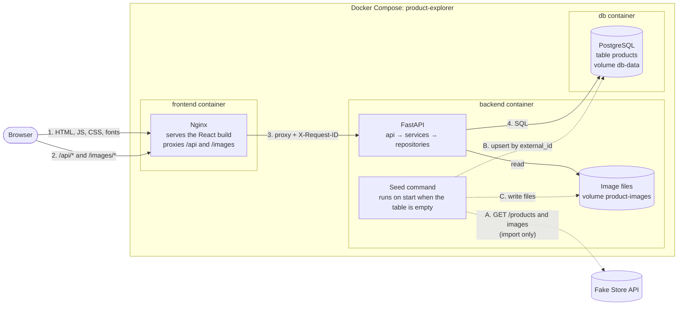

# Product Explorer

A small fullstack product catalogue: a paginated list with search and a
category filter, and a page for each product. The React frontend talks only
to our own REST API, which serves data that was imported once from
[Fake Store API](https://fakestoreapi.com) into PostgreSQL.

| | |
| --- | --- |
| Frontend | React 19, TypeScript, Vite, React Router, Redux Toolkit, MUI, i18next |
| Backend | Python 3.13, FastAPI, SQLAlchemy 2, Alembic, Pydantic |
| Database | PostgreSQL 17 |
| Runtime | Docker Compose: `frontend` (Nginx), `backend`, `db` |

## Quick start

**Prerequisites**

- Docker with Compose v2 (Docker Desktop or Docker Engine).
- Ports 8080 and 8000 free on your machine (both can be changed, see
  [Environment variables](#environment-variables)).
- Internet access on the first start: Docker pulls the base images and the
  backend imports the catalogue from Fake Store API.

**Run**

```bash
git clone https://github.com/mtombolini/product-explorer.git
cd product-explorer
docker compose up --build
```

`docker-compose up --build` works as well. No `.env` file is needed.

The first start builds the images and imports 20 products with their
images, which takes about a minute. After that:

| What | Address |
| --- | --- |
| Application | <http://localhost:8080> |
| API documentation (Swagger UI) | <http://localhost:8000/docs> |
| OpenAPI document | <http://localhost:8000/openapi.json> |
| Health check | <http://localhost:8000/health> |

**Stop and reset**

```bash
docker compose down        # stop, keep the database and the images
docker compose down -v     # stop and delete the data (next start imports again)
```

## Environment variables

Every variable has a local default in `docker-compose.yml`, so a `.env`
file is optional. To change a value, copy `.env.example` to `.env` and
edit it. The defaults are development values, not secrets.

| Variable | Default | Purpose |
| --- | --- | --- |
| `POSTGRES_USER` | `product_explorer` | Database user |
| `POSTGRES_PASSWORD` | `product_explorer` | Database password (local only) |
| `POSTGRES_DB` | `product_explorer` | Database name |
| `DATABASE_URL` | built from the three above | SQLAlchemy URL used by the backend |
| `FAKESTORE_BASE_URL` | `https://fakestoreapi.com` | Source of the import |
| `FAKESTORE_TIMEOUT_SECONDS` | `5` | Timeout of each request to Fake Store |
| `FAKESTORE_MAX_RETRIES` | `2` | Retries after the first failed request |
| `IMAGES_DIR` | `/data/images` | Where the backend stores product images |
| `LOG_LEVEL` | `INFO` | Log level of the backend |
| `FRONTEND_PORT` | `8080` | Host port of the application |
| `BACKEND_PORT` | `8000` | Host port of the API (bound to 127.0.0.1) |

## Architecture overview



- **One origin.** The browser only talks to the frontend container. Nginx
  serves the built React application and forwards `/api` and `/images` to
  the backend, so there is no CORS and the browser never contacts Fake
  Store, not even for images.
- **Import, then local data.** Fake Store is contacted only by the seed
  command (dotted arrows). Once the table has rows the application has no
  external dependency.
- **Backend layers.** `api` (HTTP, validation, errors) → `services`
  (business rules) → `repositories` (the only code that touches the
  database). This is the Repository Pattern the statement suggests.
- **Frontend state.** Redux Toolkit keeps list pages cached by query key
  and products cached by id. The URL holds search, category and page.

More detail, including sequence diagrams of the import and of a request, is
in [docs/architecture.md](docs/architecture.md).

## Project structure

```text
.
├── docker-compose.yml          three services + two test runners (profile "test")
├── .env.example
├── README.md  AI_USAGE.md  FUTURE_IMPROVEMENTS.md
├── docs/                       SPEC, DECISIONS, architecture
├── .github/workflows/ci.yml    lint, tests and builds
├── backend/
│   ├── Dockerfile  entrypoint.sh
│   ├── requirements.txt  requirements-dev.txt  pyproject.toml
│   ├── alembic.ini  migrations/        database migrations
│   ├── app/
│   │   ├── main.py                     application factory
│   │   ├── api/                        routes, dependencies, errors, middleware
│   │   ├── services/                   business rules and the import workflow
│   │   ├── repositories/               database queries and image files
│   │   ├── clients/                    Fake Store HTTP client
│   │   ├── models/  schemas/           table model; request and response shapes
│   │   ├── core/                       settings, database session, logging
│   │   └── commands/seed.py            the import command
│   └── tests/
└── frontend/
    ├── Dockerfile  nginx/default.conf
    ├── package.json  vite.config.ts  eslint.config.js
    └── src/
        ├── main.tsx                    providers and router
        ├── app/                        store, routes, theme, hooks
        ├── api/                        fetch client and endpoint functions
        ├── features/products/          slice, URL state, product components
        ├── i18n/                       interface languages (English, Spanish)
        ├── pages/                      one component per route
        ├── components/                 layout shell and shared pieces
        └── test/                       test setup and in-memory API
```

## API endpoints

Base path `/api`, JSON only, read-only. The interactive documentation is
at <http://localhost:8000/docs>.

| Method and path | Description | Success | Errors |
| --- | --- | --- | --- |
| `GET /api/products` | One page of products | 200 | 422 |
| `GET /api/products/{id}` | One product | 200 | 404, 422 |
| `GET /api/categories` | Distinct categories, sorted | 200 | |
| `GET /health` | API, database and catalogue state | 200 | 503 |
| `GET /images/{file}` | A stored product image | 200 | 404 |

**Query parameters of `GET /api/products`**

| Parameter | Type | Default | Rules |
| --- | --- | --- | --- |
| `page` | integer | 1 | 1 to 1,000,000 |
| `page_size` | integer | 12 | 1 to 48 |
| `search` | string | none | At most 100 characters. Case-insensitive match in title or description. `%` and `_` are literal |
| `category` | string | none | At most 100 characters. Trimmed; blank means no filter. Exact match |

```bash
curl "http://localhost:8080/api/products?search=cotton&category=women%27s%20clothing&page=1"
```

```json
{
  "items": [
    {
      "id": 20,
      "title": "DANVOUY Womens T Shirt Casual Cotton Short",
      "description": "95%Cotton,5%Spandex, Features: Casual, Short Sle...",
      "price": 12.99,
      "category": "women's clothing",
      "image_url": "/images/20.png",
      "rating_rate": 3.6,
      "rating_count": 145
    }
  ],
  "total": 3,
  "page": 1,
  "page_size": 12,
  "total_pages": 1
}
```

(Three products match; one is shown here.) A page after the last one answers 200 with an empty `items` list, so the
client can still show the totals.

**Errors.** Every error has the same body:

```json
{
  "error": {
    "code": "validation_error",
    "message": "The request is not valid.",
    "details": [
      { "field": "page_size", "message": "Input should be less than or equal to 48" }
    ]
  }
}
```

| Status | `code` | When |
| --- | --- | --- |
| 422 | `validation_error` | A query or path parameter is invalid. `details` names each field |
| 404 | `product_not_found` | The product id does not exist |
| 404 | `not_found` | Unknown route or image |
| 405 | `method_not_allowed` | Wrong HTTP method |
| 500 | `internal_error` | Unexpected error. Generic message, the cause is only in the logs |

Every response carries an `X-Request-ID` header. The same id is in the
backend log lines of that request (`request_id`), which are JSON.

## Import strategy

**Approach.** A dedicated command, `python -m app.commands.seed`, that also
runs automatically when the backend container starts and the `products`
table is empty. It is implemented in
`backend/app/services/import_service.py`.

```bash
# Run the import by hand (always imports, safe to repeat):
docker compose exec backend python -m app.commands.seed
```

**What one run does**

1. **Fetch** `GET {FAKESTORE_BASE_URL}/products` with a timeout and retries
   with backoff.
2. **Validate** every record with a Pydantic model. `id`, `title`, `price`
   and `category` are required; `description`, `image` and `rating` are
   optional. An invalid or repeated record is logged and skipped.
3. **Upsert** the valid records in one statement:
   `INSERT ... ON CONFLICT (external_id) DO UPDATE`.
4. **Download images** that are not stored yet into a Docker volume, after
   checking the host, the content type and the size. The backend serves
   them under `/images`.
5. **Log a summary**: fetched, imported, skipped, images downloaded and
   failed.

| Topic | How it is handled |
| --- | --- |
| **Advantages** | Reproducible with one command; runs by itself on a clean start; the running application never depends on Fake Store; easy to test because the HTTP transport can be replaced |
| **Limitations** | The first start needs internet access and waits for the import; there is no schedule, so later changes in Fake Store only arrive when the command is run again; products removed at the source are not removed here; with several backend replicas the start-up import should become a separate job |
| **Idempotency** | The Fake Store id is stored as `external_id` with a unique constraint and is the key of the upsert. Running the import any number of times leaves the same rows with the same ids. Images already on disk are not downloaded again |
| **Validation** | Each record is validated on its own, with bounds that match the table columns. One bad record never stops the run |
| **Error handling** | Transport errors and HTTP 5xx are retried. If the product list cannot be fetched, nothing is written and the command exits with code 1. A failed image is logged and the product keeps a placeholder; after three image failures in a row the remaining images are left for the next run |

**When Fake Store API is unavailable**

- *During the first import (empty database):* the failure is logged, the
  API still starts, `GET /health` answers 200 with
  `"catalogue_seeded": false`, and the application shows "The catalogue is
  empty" with a "Try again" button. Running the seed command later fills
  the catalogue without a restart.
- *After a successful import:* nothing happens. A start with rows in the
  table skips the import and makes no network call, and all pages keep
  working from the local database and the stored images.
- *Images only:* products are imported, the missing images show a
  placeholder, and the next run of the command downloads them.

## Tests

No local toolchain is needed: both suites run in containers.

```bash
# Backend: 62 tests (pytest) against PostgreSQL, in a database ending in _test
docker compose --profile test run --rm --build backend-test

# Frontend: 51 tests (Vitest + React Testing Library)
docker compose --profile test run --rm --build frontend-test
```

Lint and format checks:

```bash
docker compose --profile test run --rm backend-test ruff check .
docker compose --profile test run --rm backend-test ruff format --check .
docker compose --profile test run --rm frontend-test npm run lint
docker compose --profile test run --rm frontend-test npm run format:check
docker compose --profile test run --rm frontend-test npm run typecheck
```

The tests never call the real Fake Store API: the backend replaces the
HTTP transport with `httpx.MockTransport`, and the frontend replaces
`fetch` with an in-memory copy of our API.

| Suite | What is covered |
| --- | --- |
| Backend, import | Idempotency (two runs, same rows), update in place, invalid records skipped, failed image keeps the placeholder, three failures stop the downloads, source unavailable leaves the table untouched, retries |
| Backend, API | Pagination metadata and edge pages, category filter, search (case, title or description, `%` and `_`), every validation rule (422), 404, 405, 500 without internals, request id, health with and without products and with the database down |
| Backend, service | Pagination maths and filter clean-up with an in-memory repository, no database |
| Frontend, flows | Search after a pause and category filter (requests, URL, announced count); pagination; opening a product and going back with no new request; direct visit fetches once |
| Frontend, states | Error with retry, filtered empty state with "Clear filters", empty catalogue, page past the end, product not found, malformed id, unknown route |
| Frontend, units | API client errors, URL parsing, cache rules of the slice |
| Frontend, languages | Switching to Spanish and back, plurals, translated states, same keys in every language, price and rating formats |

## Development workflow

The full stack in Docker is the reference. For a faster loop while
changing code:

```bash
# Frontend with hot reload on http://localhost:5173.
# Vite proxies /api and /images to the backend container on port 8000.
docker compose up -d
cd frontend && npm ci && npm run dev

# Backend: rebuild and restart only that container after a change.
docker compose up -d --build backend
```

Useful commands when investigating a problem:

```bash
docker compose ps                                  # state and health of the services
docker compose logs -f backend                     # JSON logs, one line per request
docker compose logs backend | grep <request-id>    # every line of one request
docker compose exec db psql -U product_explorer    # inspect the database
docker compose exec backend python -m app.commands.seed   # run the import again
curl -i "http://localhost:8080/api/products?page_size=500" # see an error envelope
```

To follow one request end to end: copy the `X-Request-ID` response header
from the browser's network panel and search for it in the backend logs.

## Accessibility and responsive behaviour

- Landmarks (`header`, `main`, `footer`, a `search` form), one `h1` per
  page, a skip link as the first focusable element.
- Every control has a name and a visible 3 px focus ring. Controls are 36
  to 40 px tall with a mouse and at least 44 px on touch screens.
  Everything works with the keyboard alone: the category buttons are one
  Tab stop and the arrow keys move between them, and the language menu
  opens with Enter and closes with Escape.
- After a change of page, focus moves to the new page's heading. The result
  count is a polite live region. The current page of the pagination has
  `aria-current`.
- Product cards are single links. Ratings have a text equivalent.
- Motion is short (150 to 300 ms). Under `prefers-reduced-motion`
  movement is removed; a short fade remains.
- The grid has 1 column below 480 px, 2 from 480 px, 3 from 768 px and 4
  from 1200 px. The header is fixed and becomes shorter after scrolling
  without moving the page. On desktop a toolbar with the category filter
  and the result count stays in view under it.

**Measured** on the Docker stack with Lighthouse 13.5.0 (accessibility
category, headless Chrome): **100** on `/products`, `/product/1` and the
empty state, with no failed audit.

| Use | Foreground | Background | Contrast | Required |
| --- | --- | --- | --- | --- |
| Body text | `#111111` | `#FFFFFF` | 18.88:1 | 4.5:1 |
| Secondary text, placeholder | `#484848` | `#FFFFFF` | 9.15:1 | 4.5:1 |
| Header text, primary buttons | `#FFFFFF` | `#0058A3` | 7.18:1 | 4.5:1 |
| Links and text buttons | `#0058A3` | `#FFFFFF` | 7.18:1 | 4.5:1 |
| "Top rated" badge | `#111111` | `#FFDB00` | 13.83:1 | 4.5:1 |
| Focus ring on white | `#0058A3` | `#FFFFFF` | 7.18:1 | 3:1 |
| Focus ring on the header | `#FFDB00` | `#0058A3` | 5.26:1 | 3:1 |

Yellow is only used as a background (brand mark, badge, focus ring on
blue), never as text and never behind white text.

## Languages

The interface is available in **English and Spanish**. English is the
default; the menu in the header changes it and the choice is remembered
in the browser.

- All interface copy is in `frontend/src/i18n/locales/`, one file per
  language. English defines the shape, so a missing translation is a
  compile error.
- Plurals and word order come from the message files ("1 product",
  "2 productos"), and prices and ratings are formatted with `Intl`
  for the chosen language (`$109.95` and `109,95 US$`).
- The API is language-neutral: it returns stable error codes and the
  interface chooses the wording.
- `<html lang>` follows the chosen language.

To add a language: copy `locales/en.ts` to a new file and translate it,
add the language to `SUPPORTED_LANGUAGES` in `i18n/languages.ts` and to
`resources` in `i18n/i18n.ts`.

Catalogue content is **not** translated: titles and descriptions come from
Fake Store in English only and are marked with `lang="en"`. The four known
category names are translated in the frontend.

## Assumptions

- **No authentication.** The catalogue is public and read-only.
- **Catalogue content.** The statement mentions home furnishing products;
  Fake Store returns clothing, electronics and jewellery. The data is kept
  as it is and the interface copy stays neutral ("products").
- **Currency.** Fake Store prices have no currency; they are shown as US
  dollars.
- **Search** matches title and description. **Category** is the single
  filter. Sorting is intentionally left out of this version.
- **Images** belong to the catalogue data, so they are imported and served
  from our backend like the rest.
- **Cache lifetime.** Data fetched by the frontend is kept until the page
  is reloaded, because the catalogue only changes when the import runs.
- **Reviewer environment.** A current Docker installation where
  `docker-compose` is Compose v2.

The full list, with the open questions and the defaults taken, is in
[docs/SPEC.md](docs/SPEC.md).

## Known limitations

- The catalogue has 20 products. Search uses `ILIKE` with a leading
  wildcard, which does not use an index and would be slow on a large table.
- Prices travel as JSON numbers. That is fine for display, not for money
  arithmetic.
- The frontend ships as one JavaScript bundle of about 790 kB (250 kB
  compressed). React, MUI, the router and the motion library account for
  most of it.
- The import is manual after the first start and never deletes products.
- The first start needs internet access; an offline first start gives an
  empty catalogue until the seed command is run.
- The local default credentials are in `docker-compose.yml`. They are
  development values and must be replaced outside a local machine.
- No end-to-end browser tests are part of the repository. The browser
  checks described in `AI_USAGE.md` were run with throwaway scripts.
- Product titles and descriptions are shown in English in every interface
  language, and the browser language is not detected: a first visit is in
  English.
- Tested in Chrome only. No screen reader session was run.
- The CI workflow was written and linted but has not run on GitHub yet.

## Path to production

A short view of what would change. The prioritised plan is in
[FUTURE_IMPROVEMENTS.md](FUTURE_IMPROVEMENTS.md).

- **Security.** Real secrets from a secret manager instead of defaults;
  TLS terminated at a load balancer or ingress; a Content-Security-Policy
  and HSTS in Nginx; rate limiting on the API; dependency and image
  scanning in CI; a read-only database role for the API and a separate one
  for migrations and the import.
- **Scalability.** The API is stateless, so it scales horizontally behind
  the proxy. Migrations and the import move out of the container start
  into one-off jobs, so replicas do not race. Images move to object
  storage behind a CDN. Search moves to PostgreSQL full-text or trigram
  indexes. A managed PostgreSQL with backups replaces the container.
- **Monitoring.** The JSON logs and request ids are ready for a log
  platform. Next would be metrics (request rate, errors, latency), traces
  with OpenTelemetry, alerts on `/health` and error rate, and separate
  liveness and readiness probes.

## Further documents

| Document | Content |
| --- | --- |
| [docs/SPEC.md](docs/SPEC.md) | Requirements checklist mapped to the statement, assumptions, design contract |
| [docs/architecture.md](docs/architecture.md) | Diagrams of the containers, the import and a request; the layers |
| [docs/DECISIONS.md](docs/DECISIONS.md) | Each decision with its alternatives and trade-off |
| [AI_USAGE.md](AI_USAGE.md) | How AI was used, what was rejected and how the output was verified |
| [FUTURE_IMPROVEMENTS.md](FUTURE_IMPROVEMENTS.md) | Limitations and a prioritised improvement plan |
