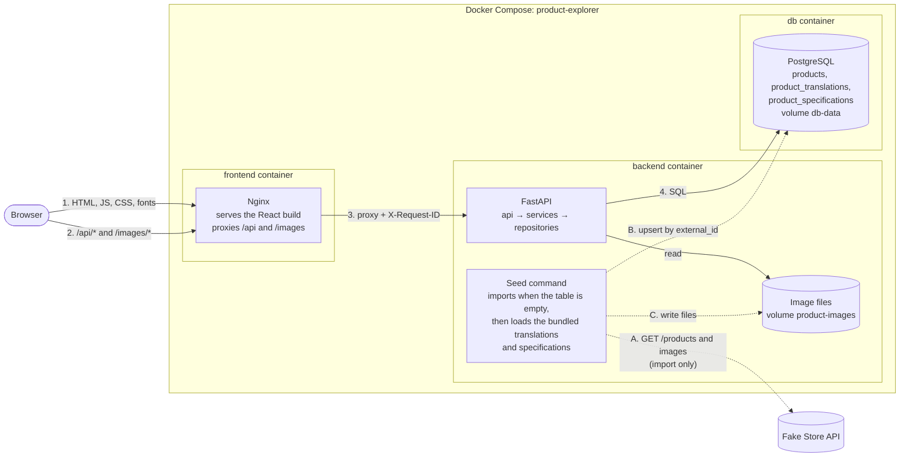
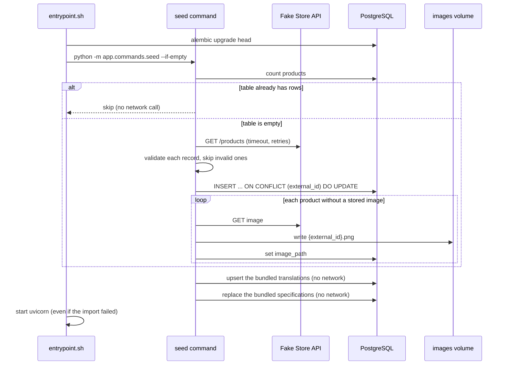
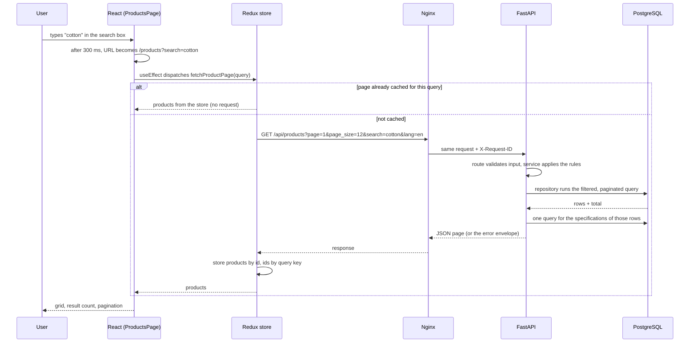

# Architecture

## Containers and data flow

Solid arrows are the path of every user request. Dotted arrows are the
import, which is the only moment the system talks to Fake Store API. The
browser never does: it only knows one origin, the frontend container.

## The two flows

### Import (once, or on demand)

### A catalogue request

## Layers

**Backend** (`backend/app`). Each layer only knows the one below it.

| Layer | Folder | Responsibility |
| --- | --- | --- |
| API | `api/` | HTTP: parameters, validation, status codes, error envelope, request id |
| Services | `services/` | Business rules: pagination maths, filters, not found, the import workflow, the translation and specification loaders |
| Repositories | `repositories/` | The only code that touches the database session or the image files |
| Clients | `clients/` | Calls to Fake Store API |
| Models and schemas | `models/`, `schemas/` | Tables, languages and sort orders; shapes of requests, responses, imported records, translations and specifications |
| Core | `core/` | Settings, database session, logging |
| Commands | `commands/` | The seed command |

**Frontend** (`frontend/src`).

| Folder | Responsibility |
| --- | --- |
| `api/` | The only code that calls `fetch`; one error type |
| `app/` | Store, typed hooks, routes, theme, motion values |
| `features/products/` | The slice (state, thunks, cache rules), URL state, product components |
| `pages/` | One component per route; loads data in `useEffect` and picks the state to show |
| `i18n/` | Interface languages: setup, one message file per language, category names |
| `components/` | Layout shell and shared pieces |
| `test/` | Test setup, the in-memory API and the render helper |
